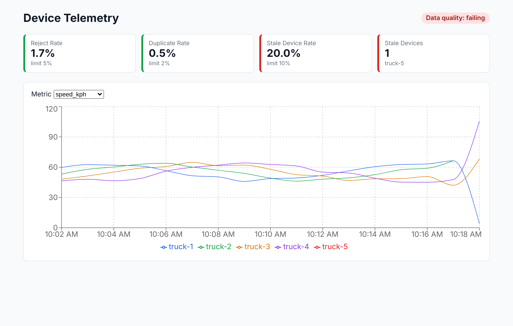

# Telemetry Pipeline

A small end-to-end pipeline for device telemetry: a validated ingestion API, data-quality checks,
and a live React dashboard.



## What it does

- **Validated ingestion** – `POST /ingest` accepts a batch of events. Each event is checked against a
  typed schema (Pydantic): known metric names, numeric values, timezone-aware timestamps.
- **Dead-letter table** – invalid events don't fail the batch. They're stored in a `dead_letter`
  table with the original payload and the exact validation error (`GET /dead-letter`).
- **Duplicate handling** – retried events with an already-seen `event_id` are counted, not
  double-inserted.
- **Time-bucketed metrics** – `GET /metrics?bucket_seconds=60` aggregates count/avg/min/max per
  device and metric using portable SQL bucketing (`floor(epoch / size) * size`).
- **Data-quality endpoint** – `GET /quality` reports reject rate, duplicate rate, and stale devices
  (no data within `STALE_AFTER_SECONDS`) with pass/fail thresholds.
- **Dashboard** – React + TypeScript with a typed API client, polling every 5 s, a per-device chart,
  quality cards, and a clear error state when the API is down.

## Architecture

```
devices / simulator ──► FastAPI /ingest ──► schema validation ──┬─► events (DuckDB)
                                                                └─► dead_letter (DuckDB)
                         FastAPI /metrics, /quality ◄── SQL aggregates
                                   ▲
                    React dashboard (polling)
```

## Run it

```bash
# API
cd backend
pip install -r requirements-dev.txt
uvicorn app.main:app --reload            # http://localhost:8000/docs

# or with Docker
docker compose up --build

# send simulated telemetry (with some bad and duplicate events)
python scripts/simulate.py --devices 5 --batches 30

# dashboard
cd dashboard
npm install
npm run dev                              # http://localhost:5173
```

## Configuration

| Variable | Default | Meaning |
| --- | --- | --- |
| `DB_PATH` | `:memory:` | DuckDB file path |
| `MAX_REJECT_RATE` | `0.05` | Fail if more than 5% of events are rejected |
| `MAX_DUPLICATE_RATE` | `0.02` | Fail if more than 2% are duplicates |
| `MAX_STALE_RATE` | `0.10` | Fail if more than 10% of devices are stale |
| `STALE_AFTER_SECONDS` | `300` | A device is stale after this long without data |
| `CORS_ORIGINS` | `http://localhost:5173,...` | Allowed dashboard origins |

## Tests and CI

- Backend: 12 unit and integration tests (`pytest`), linted and format-checked with `ruff`.
- Dashboard: component tests with Vitest + Testing Library (rendering and API-down handling),
  ESLint, and a production build.
- GitHub Actions runs both suites and builds the Docker image on every push.

```bash
cd backend && pytest -q
cd dashboard && npm test
```

## Tech

Python, FastAPI, Pydantic, DuckDB, SQL, pytest, Docker, GitHub Actions, TypeScript, React, Vite,
Recharts, Vitest.
